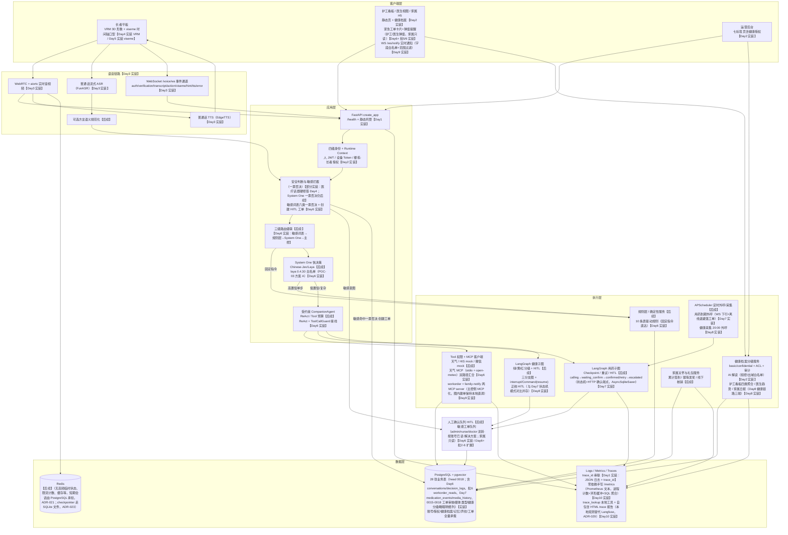

# 架构与 Agent 闭环图

> 标注说明：【Day1 实装】= 本阶段已交付；【Day2 实装】= Day2 已交付（账号授权、健康档案、四页前端、三主题）；【Day3 实装】= Day3 已交付（WebRTC/FunASR/EdgeTTS/CAMPPlus 声纹全链路）；【Day4 实装】= Day4 已交付（VRM 3D 形象、LLM 流式对话、会话持久化）；【Day5 实装】= Day5 已交付（viseme 时间轴口型、熔断三档、延迟观测）；【后续】= 后续阶段能力，暂不实现。

## 闭环说明

1. **请求进入**【Day1 实装基础链路】：Uvicorn → `create_app()` → TraceIdMiddleware（合法 `X-Trace-ID` 透传/非法重生成，contextvars 绑定，响应头回传）→ 异常边界 → API 路由 → StaticFiles 根路径托管前端。Day1 仅 `/health`；Day2 起承载全部业务 API。
2. **身份与安全**【Day2 实装账号授权部分】：人 JWT / 设备 Token 双凭证体系（迁移 0003/0004）、护工-楼栋 / 医生-长者 / 家属-长者授权关联、范围外 404 隐藏存在性；四级身份级联（设备绑定→房间候选→声纹→主动确认/护工授权）中的声纹与主动确认仍为【后续】。
3. **健康档案闭环**【Day2 实装】：范围判定 → health_grants ACL → basic/confidential 分级过滤三层访问控制；写操作留审计流水；护工待录入/预警、医生全档编辑+摘要+导出、家属查看+已阅+AI 解读（仅 basic 级脱敏出域、每小时 1 次频控、失败不留档，ADR-017）。
4. **三级路由**【Day6 实装】：敏感词表（一票否决）→ 规则层 10 条表驱动 → System One（laya 高置信快路由，ADR-022）→ 唯一受约束主控 CompanionAgent（ReAct + ToolCallGuard）；简单请求在规则层/System One 闭环（S1 闭环率实测 68.75%，≥60% 目标达成）。
5. **执行**【Day7-8 实装】：确定性服务 / MCP Tool（天气 Day6 + workorder/family-notify Day9）/ LangGraph 子图（用药状态机 Day7、健康三分支 interrupt Day8）；高危副作用必须 HITL 确认后执行（副作用零越权经 Day9 攻击测试实证）。
6. **数据**【实装 28 业务表】：PostgreSQL + pgvector 承载业务数据（head 0018）、长期记忆（1024 维 pgvector + ivfflat）、声纹与工单审核链；短期会话由 PostgreSQL 承担（ADR-021）、图 Checkpoint 走 SQLite 文件（ADR-023）；Redis 始终未引入（Day10 收官口径：无分布式/高并发需求，不换 Celery+Redis）。
7. **观测闭环**【Day1→Day10 演进】：结构化 JSON 日志 + trace_id（Day1）→ decision_logs 全链路留痕（Day6）→ 零依赖手写 /metrics + trace_lookup 本地工具 + 自包含 HTML trace 报告（Day10，本地观测替代 Langfuse，ADR-029）；语言大模型观测平台（Langfuse Cloud/自建）经决策放弃，理由与回切入口见 ADR-029。

## Day1 实装清单

- FastAPI 应用工厂 + `/health`（不访问数据库）
- Pydantic Settings 统一配置（后续字段 Optional）
- 结构化 JSON 请求日志 + trace_id 中间件
- PostgreSQL 异步引擎/会话入口 + SQLAlchemy 2.x 11 表 ORM
- Alembic 两版初始迁移（0001 核心四表 / 0002 领域七表）

## Day2 实装清单

- 迁移 0003（accounts、device_tokens）/ 0004（护工-楼栋、医生-长者、家属-长者授权关联）/ 0005（健康档案五表）
- 人 JWT 登录、设备注册/凭证吊销、`/auth/me`、基于授权关联的角色范围判定（范围外 404）
- 健康档案服务：三层 ACL 读写、审计流水、医生摘要+家属已阅、打印版导出、护工待录入清单与预警视图、管理员授权矩阵与健康审计
- 健康 AI 解读：OpenAI 兼容适配器（环境变量注入）、basic 级出域白名单、频控与 503/429/502 语义、`/config/flags` 公开开关
- 前端四页改造（nurse/doctor/family/admin）+ 三主题系统（陶瓷白默认/暖陶雅集/夜空黑）+ 登录首页与调试页
- 测试：pytest 全量通过（含 POC-05 攻击用例与健康档案 ACL 用例）

## Day2 之前明确不实装（后续能力）

WebRTC、ASR/TTS、方言规范化、声纹推理、System One、主控 Agent、
MCP 工具、LangGraph 业务图、APScheduler 外呼、家属签到与礼包、Docker 全量部署。

## Day3 实装清单（2026-11-05）

> Day3 将上节「后续能力」中的 WebRTC、ASR/TTS、声纹推理三项提前落地（POC-01/02 实测通过后进入正式模块）；方言规范化、System One、主控 Agent 等仍为【后续】。

- POC 先行：POC-01 WebRTC 本地回声实测通过（`scripts/poc01_webrtc_echo.py`；跨机器待教师 TURN 凭据）、POC-02 FunASR 流式 ASR + Edge-TTS 实测通过（说完→最终转写 242ms，TTS 首包基线 1331ms）。
- `compose.funasr.yaml`：FunASR 实时识别容器（host 10096→容器 10095，模型卷持久化），停容器即触发语音降级通道。
- `app/integrations/` 三 Provider（ADR-018）：`funasr_ws.py`（WSS 2pass 流式，offline 结果即终句，10s 结果死线）、`edge_tts.py`（Edge-TTS + PyAV 解码 16k，免 ffmpeg）、`sherpa_voiceprint.py`（CAMPPlus 192 维 + TEN-VAD，存储无关）。
- `app/services/voice.py`：VoiceSession 声纹门控状态机（feed_pcm → 服务端 VAD → 语音段 → 声纹验证/转写），阈值 0.55，300s 临时验证 Token 仅内存（`voice_token_store` 模块单例），模板回复 + TTS 播报，`embedding_reloader` 会话内快照现场重查。
- `app/realtime/session.py`：aiortc RTCSessionManager（按 device_id 键控、重复 offer 关旧建新、推送循环单帧异常自愈）。
- `app/api/routes/voice.py`：`WS /voice/ws`（首条消息鉴权：设备 Token / 管理员 JWT 互斥）、`POST /voice/enroll/device`、`POST /voice/enroll/admin`（双人间管理员通道，ADR-005 落地）、`GET /voice/voiceprints`；晚间追加生物识别演示接口 `GET /voice/biometric/rooms`、`POST /voice/biometric/login`（见下）。
- 前端：`voice.html` 独立适老语音测试台（WebRTC + WS 双通道、声纹录入 AudioWorklet 5s 窗、TTS 播放期静音麦克半双工防回声）；`elder.html` 增语音入口；`index.html` 登录页视频背景（无缝循环视频 + 海报兜底 + 播放拦截/减弱动效/待机暂停四重降级）与「老人生物识别进入」（房间号直选 + 指纹演示点击即进 / 声纹真比对 Day3 声纹库，经 `BIOMETRIC_DEMO_ENABLED` 开关控制，默认开）。
- 静态资产入库：端侧 VAD WASM（12.5MB）、登录页视频与海报（`app/static/media/`）、指纹图标 PNG（用户指定样式原图转透明底）。
- 测试：语音四件套 28 例 + 生物识别 9 例，全量 **136 passed** 零回归；`AGENTS.md` 追加实时/语音模块 6 条规则，realtime 列入高风险审查清单。
- 实测事故沉淀 9 起并全部修复（FunASR offline 不带 is_final、TTS onended 不可靠致麦克永久静音、零音频 finish 致会话永久卡死→10s 结果死线 + 静音缓冲禁入 ASR 等，详见 Git 提交 0b25e2b…289ba42）。

## Day4 实装清单（2026-11-06）

> 上图 PAD 节点「VRM 3D 形象 + viseme 口型【后续】」中的 **VRM 3D 形象部分**于本日提前落地（viseme 口型仍为能量近似，Day5 升级）；回复生成进入真实 LLM（System Two），三级路由/System One/主控 Agent/Tool 仍为【后续】。

- 前端：three-vrm 本地化渲染（零外部 CDN 依赖），`app/static/js/avatar.js` 引擎封装 + 7 个 VRM 形象注册表驱动切换，加载失败自动回落且不影响语音链路；口型同步以音频能量近似驱动（TTS → MediaStreamDestination → 引擎 analyser）。
- 回复链升级：LLM 流式分句（`app/integrations/llm.py`，Qwen 兼容 API + 人设 few-shot prompt + `_SentenceAssembler` 凑句即产出），`[act:*]` 动作标记剥除后经 WS `action` 事件单独下发（不朗读、不进字幕），`app/services/actions.py` 动作表驱动 3D 动作；医疗话题硬拒答（few-shot 约束 + 真实链路实测验证）。
- 会话持久化（ADR-021）：迁移 0006 `conversation_messages` 成对落库（user/assistant），LLM 上下文注入最近 5 轮，替代 Redis 短期会话（上图 REDIS 节点仍为【后续】）。
- 语音链路加固：TTS 回声防护窗（播放期静音麦克 + 服务端超时兜底双防线）、VAD 连续帧起判（SPEECH_ONSET_MS）与最小语音时长过滤（MIN_SPEECH_MS）、FunASR 零结果自适应死线（消除噪声伪终句阻塞）。
- 测试基线 192 例全绿（+47），覆盖率 61%。

## Day5 实装清单（2026-11-07）

> 上图三处口径随本日更新：① PAD「viseme 口型」由能量近似升级为音素级时间轴（该【后续】标注项已实装）；② 数据层实装表数 20→22（Day4 加 conversation_messages、Day5 加 latency_metrics）；③ SAFE「安全判断」中的医疗话题硬拒答已在 LLM 链路生效（System One 一票否决仍为【后续】）。三级路由、System One、主控 Agent、Tool/MCP 仍为【后续】，其中 Tool 防护框架已预埋（见下）。

- 口型同步升级（POC-02 复测通过）：`edge_tts.py` 利用 WordBoundary 事件换算「词→口型→时刻」viseme 时间轴，WS `viseme` 事件**先于同句音频**下发；前端 `playViseme` 以播放起点为 t0 调度五种近似口型，引擎不支持时零改动回落能量口型。
- 延迟观测：迁移 0007 `latency_metrics`（asr_wait_ms / llm_first_ms / llm_total_ms / tts_first_ms / e2e_ms 分列 + placeholder_used / success 标记），每轮回复落 1 行，POC-08 用 SQL percentile_cont 复算 P50/P95。
- 熔断三档（大纲 5.2）：ASR 终句超 2s → 朗读"没听清，请再说一遍"（asr_prompt_seconds）；LLM 首 token 超 3s → 播拟真占位语"嗯~我想想哈。"（llm_placeholder_seconds，每轮至多 1 次）；TTS 首包超 1s → 字幕先行（tts_slow_seconds）。均经 WS `hint`/`tts` 事件可见降级，不中断通话。
- 延迟根因修复：POC-08 固定 20 语句 ×20 轮跑批定位 qwen3 思考模式为首 token 瓶颈，`stream_chat` 显式下发 `enable_thinking=false`（服务端不识别时 400 自动去字段重试）——首 token 2980ms→483ms（-84%），e2e P50 4480ms→2561ms、P95 10600ms→4560ms（-57%）；剩余大头为 EdgeTTS 首包 ~1.3s（免费非流式），教学口径暂不更换，EM-01（≤1.5s）未达标如实记录于 POC-08，留待流式 TTS 选型（候选：DashScope CosyVoice / 火山豆包 / Azure Speech / 开源自部署）。
- Tool 防护预埋：`app/services/guard.py` ToolCallGuard 调用预算 + 熔断窗口双闸（假时钟 7 例单测），Day6 接 MCP Tool 调用点零改动生效；文字输入通道接入同一条 LLM 回复管线（空文本拒绝零副作用、500 字截断成轮）。
- 信令专项（POC-07 定案）：ICE answer 生成实测 P50=7.5ms / P95=15.9ms，Day3 记录的 5 秒为环境瞬态，远优于 5 秒目标。
- 演示前体验优化：`voice.html` 新增老人生物识别免 Token 进入（房间选择 → 指纹演示直进 / 声纹真比对 Day3 声纹库，后端签发短效设备 JWT 自动连接，显式 Token 输入模块保留）；数字人四态状态徽章（待机灰 / 聆听蓝 / 思考橙黄律动 / 回复绿律动，单一状态机 WS 事件驱动防卡状态）；生物识别房间弹窗流转修复。
- 测试基线 252 例全绿（+3），覆盖率 67%→70%（达标线 ≥70%）；迭代标签 `iter2-demo`（本地，未 push）。

## 当前已完成 vs 后续能力（截至 Day5，历史快照）

| 能力 | 状态 |
| --- | --- |
| FastAPI 地基 / 身份权限 / 健康档案 / 四页前端 | ✅ Day1-2 |
| WebRTC + FunASR + EdgeTTS + CAMPPlus 声纹（生物识别进入） | ✅ Day3 |
| VRM 3D 形象 + LLM 流式对话 + 动作标记 + 会话持久化 | ✅ Day4 |
| viseme 时间轴口型 / 熔断三档 / 延迟观测与基线 / ToolCallGuard 框架 / 状态徽章 | ✅ Day5 |
| 四级级联路由（敏感词表→规则层→System One→主控 Agent）/ MCP 天气工具 / 敏感词表一票否决 + HITL 敏感工单队列 | ✅ Day6 |
| 对话块分层结构 / 北京时间统一 / 老人端对话记录视图 / 工单四端卡片+弹窗 / 按账号独立已读 / 解决方案列 | ✅ Day6+ 批1-6 |
| 方言语义规范化、System One、三级路由、主控 Agent、Tool/MCP 实调、LangGraph 子图、APScheduler 外呼、家属签到礼包、流式 TTS 选型、Docker 全量部署 | 【后续】Day6 起 |

## Day6 实装清单（2026-11-09）

> 上图 ROUTE / S1 / AGENT / RULE / TOOLS / HITL / SAFE 等节点于本日由【后续】追加【Day6 实装】标注（节点仅加注、结构未变）。四级级联路由口径：**敏感词表 → 规则层 → System One（laya）→ 主控 Agent**，敏感命中一票否决，全程零自由文本生成。

- 四级级联路由：`app/router/` cascade.py 接入 voice.py —— safety.py 敏感词表（六类，隔字正则抗干扰）→ 规则层 10 条表驱动（固定指令直达、零模型）→ System One 契约（9 字段）+ laya 适配器（懒加载 / 200ms 超时降级）→ 主控 CompanionAgent（ReAct + ToolCallGuard 接线 + 决策降级直答）。
- 敏感一票否决 + HITL 工单：命中只播安抚话术、不调用大模型；工单落 `workorders(type=sensitive_alert)`，`decision_logs` 全程留痕（迁移 0008）；admin 列表/流转两端点 + 敏感事件 Tab。
- MCP 天气 Tool：stdio + open-meteo + 重试降级（mock 可见话术），规则/S1 双路径汇合同一回复管线；`report_emergency` 第四道防线 Tool（批2）。
- 权重白名单：laya 0.4.30 + pinned revision（AGENTS.md 豁免注记，POC-03 方案 A 裁决）；评测基线 50 条（意图准确率 96.4% / 敏感召回 100%，`eval/reports/day6_router_baseline.md`）。
- 测试基线 252→361 全绿，覆盖率 70%→73%。详见 [Day6_验收报告.md](../Day_plan/Day6_验收报告.md)。

## Day6+ 追加批次清单（批1-6，2026-11-09）

| 批次 | 提交 | 内容 |
| --- | --- | --- |
| 前置 | `550b444` | 天气精简答复流式化（句末即逐句 TTS）：e2e P50 -24% / P95 -33%，P95 反超 Day5 基线 |
| 批1 | `9647f13` | 敏感词表隔字正则（「胸口有点疼」类拆字绕过）；明天/后天天气规则内收口 date 参数；voice.html 天气数据卡 |
| 批2 | `99eabe2` | 敏感工单分级可见性矩阵（abuse 仅 admin+family，护工/医生不可见；迁移 0009 `workorders.category`）；护工/医生弹窗提醒；family 只读关联长者；`report_emergency` Tool |
| 批3 | `d8c3efd` | 对话记录双端可见：老人端声纹验证后最近 20 轮（服务端 Runtime Context 判定 elder，未验证 403）；管理端按长者全历史 + decision_logs 路由叠加 |
| 批4 | `a617af7` `53389a9` | 对话记录重构：左侧固定面板 + 分层对话块（每次「开始对话」新开块、块ID+子对话ID 两级、北京时间统一、倒序、工单标记）；修复 `KB.session` 笔误致管理端加载器 IIFE 崩溃 |
| 批5 | `296b41b` | 紧急工单卡片内嵌护工/医生/家属工作台（护工/医生 10s 轮询弹窗、家属只读）；老人端对话块点击展开/收起 |
| 批6 | `559d69f` | 工单按账号独立已读（`workorder_reads` 表，迁移 0010）+ 行点击详情弹窗（打开即标已读）；resolve 开放护工/医生（abuse 仍仅 admin），原因说明+解决方案必填（`workorders.solution` 独立列）；家属端可见处理状态与解决方案 |

## Day7 实装清单（2026-11-10）

> MEDWF / SCHED 节点于本日由【后续】追加【Day7 实装】标注；TOOLS 注册表四方共用（规则快路径/S1/主控同源）。

- 记忆五步链路（POC-07 通过）：萃取挂会话块结束钩子 → 百炼 `qwen3.7-text-embedding-flash` 1024 维（D2 方案 B）→ pgvector + ivfflat（迁移 0011/0013）→ 召回注入回复管线（top-5）→ 冲突 superseded；召回强制 elder_id 过滤（Day9 静态断言防线）。
- LangGraph 用药确认图（POC-06 用药部分通过）：`calling→waiting_confirm→confirmed/retry(≤3)→escalated`，AsyncSqliteSaver checkpointer（ADR-023）、APScheduler 到期扫描外呼（WS 下行播报+离线退避落漏服工单）、定时与对话内「我要吃药」共用一图。
- 娱乐点播：曲库弹窗+播放器+语音控制；4 条预告话术规则原位接管（rule_id 不变换 handler，10 条封顶红线不破坏）；迁移 0014 `medication_events`/`media_history`。
- 评测基线 v1：33 场景（29→33）+ 失败分层归因 + eval/gate.py 阈值门禁雏形 + tag `iter3-demo`。测试 515 例全绿。

## Day8 实装清单（2026-11-11）

> HEALTHWF 节点于本日实装；HEALThp 扩展健康链路三端。

- 健康决策三分支图：green 直存 / yellow 护工 interrupt / red 医生 interrupt + 医院 mock + 紧急工单——LangGraph `interrupt()` + `Command(resume)` 正统 HITL（与 Day7 状态机模式对比并存，D3 教学裁决）；副作用红线：interrupt 恢复前零通知零工单生效。
- 分级规则引擎（阈值在代码不在 prompt）+ 主诉急症词进 safety.py 直达 red；迁移 0017 `triage_level/triage_reason`。
- 三端：护工看板四类聚合队列（漏服/敏感待审/健康告警/求助）、医生趋势（手写 SVG 折线，零 CDN 红线守住）、家属日报卡激活；健康外呼 20:00 并入既有 scheduler。
- 声纹阈值扫描（合成口径 0.55 零误识区，真人复调注记留 Day10→注记收官）；tag `iter4-demo`。测试 586 例全绿。

## Day9 实装清单（2026-11-12）

> TOOLS 扩两 MCP server；NURSE 节点 WS 实时通知实装。

- 三道闸门攻击测试：会话隔离（thread_id 攻击面确认）、记忆隔离（pgvector 强制过滤+**源码静态断言**防未来重构删条件）、工具授权（17 条注入用例全拦截）；注入用例集 `injections.yaml` 12+ 条数据文件化。
- 日志脱敏 sanitize（身份证/手机/剂量正则 mask，grep 断言入测试）；SECURITY.md 六节成稿（OWASP LLM Top 10 逐条映射 + MCP 审计表）。
- MCP 双新 server：workorder（幂等键跨重启、留痕文件恢复映射）+ family-notify（教学 mock 微信）；主控 `emergency_report` 改走 MCP，图内建单保持本地直调（无注入面，D1 裁决）。
- 通知 WS 双通道：`/ws/notify` 仅用户 JWT（设备 token 401 互斥）、逐连接 `can_access_elder` 范围过滤、事件字段白名单（对话原文/病史滤除）、广播失败不阻断（日志通道兜底）。
- 真机重启演练收口 POC-06 升「通过」；幻觉拦截率 1.0 进门禁硬线；tag `iter5-demo`。测试 702 例全绿，工具行覆盖 100%。

## Day10 实装清单（2026-11-12 · 收官）

> OBS 节点实装本地观测双通道（Langfuse 经决策放弃，ADR-029）；部署编排与文档收官。

- Compose 三服务统一编排：pg（接管既有命名卷 `kangban_pg_data`，演示数据零丢失）+ backend（多阶段 Dockerfile，静态页/MCP/Laya 进镜像）+ funasr（profile:core 可跳过）；同学电脑「clone→cp→up」口径成立。
- 零依赖手写 /metrics：进程内计数器+1000 样本环形缓冲算 P50/P95 + decision_logs SQL 聚合（分层命中/S1 闭环率与 gate.py 同口径）。
- 观测双通道（D2 变更）：`trace_lookup.py`（--latest 时间窗回退）串全链 + 自包含 HTML trace 报告留档 `eval/reports/trace/`——**本地观测替代 Langfuse Cloud/自建**（数据不出本机、零外部依赖，回切入口保留 .env 占位，ADR-029）。
- pre-push hook 接 eval/gate.py（推送前机器强制质量红线，dry-run 验证未真推）；回滚双通道演练留档（代码回滚+镜像回滚+alembic 双向可逆）。
- 六份交付文档（演示脚本/INTERVIEW_QA 20 问/简历段落/HARNESS_DESIGN/IDENTITY_RULES/AI_USAGE）+ 复盘四件套；README 补 Docker 快速开始与成本延迟实测表。
- tag `final` 收官：723 例全绿、head 0018 零迁移、16 项验收全过（3 项诚实注记：语音双向音频浏览器未实测/trace thread_id 口径/375px zoom 模拟）。

## 当前已完成 vs 后续能力（收官版，2026-11-12）

| 能力 | 状态 |
| --- | --- |
| FastAPI 地基 / 身份权限 / 健康档案 / 四页前端 / 三主题+玻璃拟态 | ✅ Day1-2（玻璃拟态升级 2026-11-10） |
| WebRTC + FunASR + EdgeTTS + CAMPPlus 声纹（生物识别进入） | ✅ Day3 |
| VRM 3D 形象 + LLM 流式对话 + 会话持久化 | ✅ Day4 |
| viseme 时间轴口型 / 熔断三档 / 延迟观测 / ToolCallGuard | ✅ Day5 |
| 四级级联路由 / MCP 天气 / 敏感一票否决 + HITL 工单审核链 | ✅ Day6（审核终态制 ADR-024） |
| 记忆五步链路 / 用药确认图+外呼 / 娱乐点播 / 评测基线+门禁 | ✅ Day7 |
| 健康三分支图 interrupt HITL / 护工看板/医生趋势/家属日报 | ✅ Day8 |
| 三道闸门攻击测试 / 注入用例集 / 日志脱敏 / MCP 双 server / WS 通知 | ✅ Day9 |
| Compose 三服务 / 手写 /metrics / 本地 trace 双通道 / 推送门禁 / 交付文档 | ✅ Day10 |
| CI 流水线（GitHub Actions 三 job） | ✅ 已落地全绿（2026-11-12，docs/CI部署完善计划.md + ADR-031） |
| 方言语义规范化（POC-10）/ 流式 TTS 选型（EM-01）/ 家属签到礼包 / Redis+Celery / 声纹真人复调 / 真服务器 CD+域名 | 【后续可选】收官注记，见各 POC/ADR 对应口径 |
