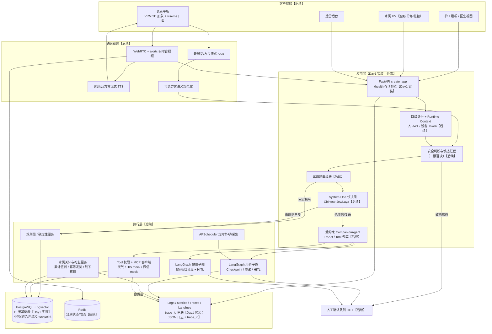

# 架构与 Agent 闭环图

> 标注说明：【Day1 实装】= 本阶段已交付；【后续】= 后续阶段能力，Day1 不实现。

## 闭环说明

1. **请求进入**【Day1 实装基础链路】：Uvicorn → `create_app()` → TraceIdMiddleware（合法 `X-Trace-ID` 透传/非法重生成，contextvars 绑定，响应头回传）→ 异常边界 → API 路由。Day1 仅 `/health`。
2. **身份与安全**【后续】：四级身份级联（设备绑定→房间候选→声纹→主动确认/护工授权）建立 Runtime Context；敏感意图安全判断优先于普通路由。
3. **三级路由**【后续】：规则层 → System One（结构化快决策）→ 唯一受约束主控 Agent；简单请求在规则层/System One 闭环。
4. **执行**【后续】：确定性服务 / MCP Tool / LangGraph 子图（用药、健康）；高危副作用必须 HITL 确认后执行。
5. **数据**【Day1 实装 11 表】：PostgreSQL + pgvector 承载业务数据、长期记忆、声纹与 Checkpoint；Redis 承载短期状态【后续】。
6. **观测闭环**【Day1 实装：结构化 JSON 日志 + trace_id】：每个请求完成日志含 trace_id、方法、路径、状态码、耗时；Metrics/Traces/Langfuse 为后续扩展。

## Day1 实装清单

- FastAPI 应用工厂 + `/health`（不访问数据库）
- Pydantic Settings 统一配置（后续字段 Optional）
- 结构化 JSON 请求日志 + trace_id 中间件
- PostgreSQL 异步引擎/会话入口 + SQLAlchemy 2.x 11 表 ORM
- Alembic 两版初始迁移（0001 核心四表 / 0002 领域七表）

## Day1 明确不实装（后续能力）

JWT/设备 Token、长者 CRUD、WebRTC、ASR/TTS、方言规范化、声纹推理、System One、主控 Agent、
MCP 工具、LangGraph 业务图、APScheduler 外呼、家属签到与礼包、Docker 全量部署。
